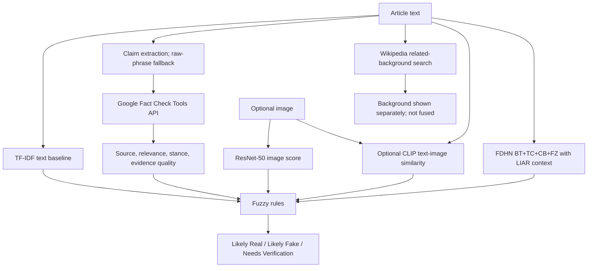

# Explainable Credibility Index

An uncertainty-aware multimodal fake-news analysis prototype.

## GitHub clone setup note

The repository intentionally excludes local datasets, downloaded images, model checkpoints, virtual environments, and API caches. Obtain the Fakeddit data from the [official dataset repository](https://github.com/entitize/Fakeddit) and follow its usage instructions, then prepare the project splits under `fakeddit_sample/`. Train the TF-IDF model with the command below and train or obtain the ResNet checkpoint separately. The large FDHN checkpoint is also excluded; FDHN is optional and the supplied legacy checkpoint is diagnostic-only. Set `FACTCHECK_API_KEY` in your local environment to enable Google Fact Check Tools. Never commit a real API key.

This repository combines a text classifier, a ResNet-50 image classifier, optional CLIP similarity, external fact-check retrieval, and a custom fuzzy rule system in a Streamlit application. It is a student research prototype. Scores inherit dataset limitations and do not establish truth.

## Architecture and data flow



The text and image branches use `fakeddit_sample/{train,val,test}.csv` (`clean_title`, `image_path`, `is_fake`, and subreddit metadata). The FDHN scripts expect LIAR tab-separated files with the 14 columns described in `fdhn/README.md`; those files are not included. External verification records are not benchmark labels.

## Research foundation and relationship to the two papers

This project is an **inspired adaptation**, not a reproduction of either paper. The model architectures, datasets, and evaluation protocols differ, so the papers' reported scores must not be presented as results of this project.

### Paper 1 — fuzzy multimodal detection

Gedara, Loia, and Tomasiello, [“A fuzzy-based multimodal approach for interpretable fake news detection”](https://doi.org/10.1016/j.asoc.2025.113277), combine an LSTM text classifier, an ANFIS image classifier, text-to-image-caption similarity, and a Mamdani fuzzy inference system. They evaluate on Twitter, BuzzFeed, and PolitiFact datasets.

Our **similarity** is the modular multimodal design: text and image are scored separately, their relationship is considered, and a fuzzy system combines available signals. Our **adaptations** are TF-IDF plus logistic regression for text, ResNet-50 for images, and optional CLIP comparison between the supplied text and image. We do not implement the paper's LSTM, ANFIS, caption-based text–image comparison, or genetically tuned membership functions. Therefore this is not an exact replication.

### Paper 2 — FDHN

Xu and Kechadi, [“An Enhanced Fake News Detection System With Fuzzy Deep Learning”](https://doi.org/10.1109/ACCESS.2024.3418340), describe FDHN with three input channels: news text, textual context, and numeric speaker context. Its modules include BERT, TextCNN, CNN-BiLSTM, and a fuzzy layer, whose representations are fused. The authors' [FDHN repository](https://github.com/chengxuphd/FDHN) documents these components and the LIAR data requirement.

Our project includes an FDHN-style inference branch for LIAR-format inputs. It is **diagnostic-only for the supplied legacy checkpoint** because the associated training code had a batch-dependent LSTM input issue; the app excludes that checkpoint from final fusion. A corrected retraining path is provided, but the resulting model must be trained and evaluated before claiming it reproduces the paper or improves accuracy.

### Project additions and limits

In addition to the paper-inspired branches, the app adds optional retrieval of published Google fact-checks with source links, a raw-phrase fallback for short text that claim extraction cannot parse, and separate Wikipedia background search. Wikipedia context is for orientation only; it is not a fact-check and does not affect the fuzzy outcome. The fuzzy policy preserves missing inputs and can return **Needs Verification** when support is limited or conflicting.

These are **engineering and uncertainty-handling additions**, not demonstrated accuracy improvements. No controlled experiment has shown this prototype to outperform either paper. To establish an accuracy improvement, compare on the same dataset and split, report per-class precision/recall/F1 and accuracy, and run ablations for each branch.

### Further improvements

1. For Paper 1's approach, add an image-caption stage and compare captions with article text; tune fuzzy memberships on validation data; and evaluate text-only, image-only, and fused variants on compatible multimodal benchmarks.
2. For Paper 2's approach, retrain FDHN with corrected batching using LIAR/LIAR2 and verified speaker metadata, then test stability and held-out performance before allowing it into fusion.
3. For the overall project, use full datasets with dependable labels, check for train/test leakage, calibrate scores, and evaluate with a separately labeled end-to-end test set. Keep web evidence separate from benchmark labels.

The app's **Start with a reproducible demo example** menu loads one held-out fake-labeled sample and one real-labeled sample from the supplied Fakeddit test split. They were selected because both saved model branches agree with those dataset labels. Fakeddit labels are subreddit-derived weak labels, so these examples demonstrate the interface and branch wiring; they are not human-verified fake-news cases.

## Run it

Use Python 3.11 or newer. Install PyTorch and torchvision from the same compatible build for your machine (especially when using CUDA), then install the app dependencies:

```bash
python3 -m venv .venv
source .venv/bin/activate            # Windows: .venv\\Scripts\\activate
python -m pip install --upgrade pip
python -m pip install -r requirements.txt
```

Train the text baseline using only the supplied training split. The command evaluates on validation and held-out test splits and writes its checkpoint and test report:

```bash
python text_branch.py --data fakeddit_sample --out text_fake_baseline.joblib --report evaluation/text_baseline.json
streamlit run app.py
```

To use FDHN, fill in all five numerical speaker-history counts in the app's FDHN context panel. The six text metadata fields can be left blank; they use the same `NaN` sentinel as the training preprocessing. The first FDHN run needs access to Hugging Face to obtain the `bert-base-uncased` tokenizer files. The large FDHN checkpoint is not included in a GitHub clone; FDHN is optional and the supplied legacy checkpoint is diagnostic-only.

To request external evidence, set a Google Fact Check Tools API key in `FACTCHECK_API_KEY` in the same terminal before launching Streamlit. On macOS/Linux:

```bash
export FACTCHECK_API_KEY='PASTE_YOUR_KEY_HERE'
streamlit run app.py
```

The key is sent in a request header and is not saved in the repository. Do not commit or share it. Google Fact Check Tools searches claims that have already been fact-checked; no matching result means only that no published review was found. A failed request is shown separately as an error. Short headlines that do not produce an extracted claim are searched as a phrase. The app also searches Wikipedia for background context, clearly separated from fact-check results and excluded from the verdict. To enable CLIP, select its option in the app and allow the optional model weights to download on first use.

For GPU training, install matching torch/torchvision builds for your CUDA version before the remaining requirements. CPU execution works but can make ResNet training slow. Because model checkpoints are excluded from GitHub, train the image branch or place a separately obtained `resnet50_fakeddit.pt` checkpoint in the project root before using image scoring.

## What each branch means

| Component | Implementation | Interpretation and limits |
|---|---|---|
| Text | `fdhn/inference.py`: upstream FDHN BT+TC+CB+FZ checkpoint for inspection when LIAR context is supplied; otherwise `text_branch.py` TF-IDF/logistic baseline | The supplied FDHN checkpoint is legacy and excluded from fuzzy fusion due to a batch-dependent LSTM bug in its training script. A corrected FDHN retrain is eligible. The fallback baseline uses weak Fakeddit subreddit labels. |
| Image | `ResNet/resnet_fake/`: ResNet-50; checkpoint `resnet50_fakeddit.pt` must be trained or obtained separately | Also trained using Fakeddit's weak labels. A fake score does not prove an image is manipulated or attached to a false claim. |
| Text-image | `clip_similarity.py`: optional pretrained CLIP cosine similarity | A semantic consistency signal only. The heuristic mismatch value is not factual evidence. |
| External evidence | `news_verify_module/news_verify/` | Extracts claims (or searches the raw phrase as fallback), retrieves Google Fact Check Tools reviews, keeps URLs/dates/excerpts, separates source reliability from stance, and handles missing or conflicting evidence. Wikipedia background is displayed separately and does not enter fusion. It does not establish ground truth. |
| Fusion | `fuzzy_fusion.py` | Custom Mamdani-style rules, max aggregation, center-of-area defuzzification, and an explicit uncertainty tie policy. Missing inputs remain `None`; at least two truth-related signal families are required for a confident class. Membership degrees are not probabilities. |
| UI | `app.py` | Provides a streamlined interface, signal/evidence/rule tabs, explicit unavailable states, and two reproducible held-out Fakeddit demo examples. External retrieval and CLIP are opt-in per analysis. |

### Fuzzy policy

For fake-score inputs, LOW and HIGH are overlapping linear shoulder sets and MEDIUM is a triangle around 0.5. Rule conjunction uses minimum; consequent strengths aggregate by maximum. The output sets are Likely Real (left shoulder), Needs Verification (triangle centered at 0.5), and Likely Fake (right shoulder); the system reports a center-of-area defuzzified value and selects the strongest output label, giving Needs Verification ties priority.

| IF condition | THEN outcome |
|---|---|
| Two available truth-related signals are HIGH | Likely Fake |
| Two available truth-related signals are LOW | Likely Real |
| Two available truth-related signals disagree | Needs Verification |
| Any relevant signal is MEDIUM | Needs Verification |
| External sources conflict, or text-image mismatch is HIGH | Needs Verification |
| Fewer than two truth-related signal families are available | Needs Verification |

The truth-related signals are a corrected FDHN or fallback text score, image fake score, and (only for moderate/strong external evidence) evidence direction. In this app, evidence that contradicts the checked claim maps toward fake; evidence that supports it maps toward real. CLIP mismatch only raises uncertainty. Missing values are excluded from the rules, never filled with 0.5.

## FDHN checkpoint and input requirements

The local project may have a 426 MB `BT+TC+CB+FZ.pt` at `fdhn/checkpoints/BT+TC+CB+FZ.pt`; model checkpoints are excluded from GitHub. The checkpoint's PyTorch archive contains the expected BERT, TextCNN, CNN-BiLSTM, fuzzy, and fusion parameter keys. `fdhn/inference.py` reconstructs the corresponding network from the upstream source and loads this state dict strictly.

FDHN was trained on LIAR claims and speaker metadata, not arbitrary full news articles. It requires the statement, six LIAR text fields (`subject`, `speaker`, `job_title`, `state_info`, `party_affiliation`, `context`), and all five LIAR speaker history counts. The UI will not invent unknown numeric counts; without them it uses the Fakeddit title baseline and marks the FDHN result unavailable for that analysis. Its six-label score mapping is documented in code and is not the original model's calibrated probability.

**The supplied checkpoint is diagnostic only.** Its matching training script fed a 2D `[batch, features]` tensor to an LSTM, which causes batch rows to be processed as sequence steps. Its output can depend on other examples and their order. `fdhn/model/2.2.BT+TC+CB+FZ.py` now uses an explicit one-step sequence and has corrected epoch metric buffers. The app only feeds a checkpoint carrying the corrected-training metadata marker into fuzzy fusion; renaming the legacy file cannot bypass this check. The trainer writes that marker to `BT+TC+CB+FZ-corrected.pt`. The provided run log records 42.38% test accuracy and 0.4253 macro F1 for the legacy checkpoint; those numbers have not been independently reproduced. See [fdhn/README.md](fdhn/README.md) for retraining instructions.

The upstream implementation describes three input channels (news text, textual context, numerical context) using BERT, TextCNN, CNN-BiLSTM, and a fuzzy layer. Its repository is MIT-licensed; the license is included in `fdhn/LICENSE`. Upstream: [chengxuphd/FDHN](https://github.com/chengxuphd/FDHN); paper: [DOI 10.1145/3628797.3628971](https://doi.org/10.1145/3628797.3628971).

## Evaluation

`evaluation/text_baseline.json` contains actual validation and held-out test results from the supplied split (6,000 train / 1,000 validation / 1,000 test titles). The current test accuracy is **0.750** and macro F1 is **0.749** at a fixed 0.5 threshold. These figures measure agreement with the dataset's weak labels, not real-world fake-news accuracy. The report includes the confusion matrix, class metrics, error rates, and fuzzy outcome coverage. With only the text signal, the policy returns **Needs Verification** for every item; it reports no confident-subset accuracy for that single-signal run.

The ResNet module includes a held-out evaluation command. Run it only after installing a matching torch/torchvision build:

```bash
python ResNet/evaluate.py --data fakeddit_sample --weights resnet50_fakeddit.pt
```

No combined-system benchmark is claimed. The available dataset does not contain fact-check retrieval ground truth, and the fuzzy rules have not been tuned on a labeled fusion dataset. To evaluate those parts, prepare a separate human-labeled, time-aware test set; do not tune on the held-out Fakeddit test split.

## Tests and checks

```bash
pytest -q tests news_verify_module/tests
python -m compileall -q app.py text_branch.py fuzzy_fusion.py clip_similarity.py fdhn/inference.py fdhn/model/2.2.BT+TC+CB+FZ.py ResNet/resnet_fake news_verify_module/news_verify
```

The external-verification tests use offline fixtures and a local HTTP test server; they do not call Google. At the last recorded run, the project test suites completed with **108 passed**. This does not measure model accuracy or verify live Google/Wikipedia requests. Use the evaluation commands above for branch metrics; no end-to-end accuracy claim is made.

## Repository layout

```text
app.py                        Streamlit interface
text_branch.py                Train/use the transparent text baseline
fuzzy_fusion.py               Uncertainty-aware fuzzy rules
clip_similarity.py            Optional CLIP consistency signal
evaluation/text_baseline.json Held-out text metrics
fdhn/checkpoints/             Local FDHN checkpoint location (not committed)
fdhn/inference.py             FDHN inference adapter
fdhn/                         Published FDHN source and training instructions
ResNet/                       Image model, data and evaluation code
news_verify_module/            Fact-check and Wikipedia context providers, tests and documentation
fakeddit_sample/              Local Fakeddit train/validation/test splits (not committed)
```
